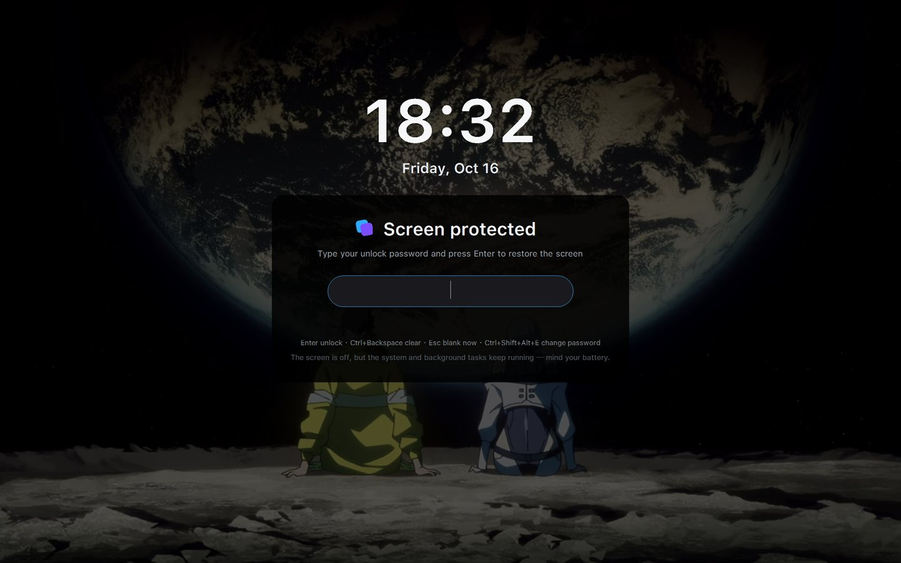
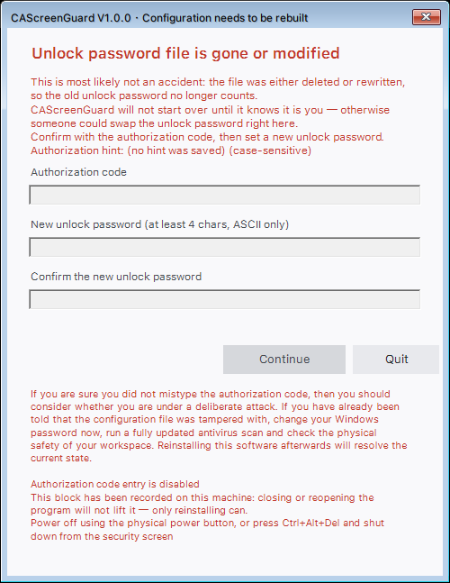

# CAScreenGuard

**English** · [简体中文](README.zh-CN.md)

# From the author: what does this software do?

**Keep long-running workflows going while the PC is unattended, and protect your ongoing work and private files from any undetectable peeking, theft, or tampering.**

*How was this built?*

*Co-developed with DeepSeek v4.1 flash, Kimi Code, DeepSeek Harness, and WorkBuddy.*

It covers the screen while you are away: it turns the monitor off (**only the monitor** — no sleep, no
session lock, the machine stays awake), puts a full-screen mask on top, and only the correct unlock
password brings the screen back.

The mask is backed by your own desktop wallpaper, dimmed and stretched over the whole screen, with the
time and date above the card laid out to Windows 11's lock-screen proportions. When the wallpaper cannot
be read it falls back to plain black. Your desktop never shows through.

- Version: **V3.2.0**
- Author: **@Conste11ation117**
- Requirements: Windows 10 / 11 with Windows PowerShell 5.1 (built in; nothing to install)
- License: [MIT](LICENSE)
- Not affiliated with JetBrains. The icon style is a homage to their icon family.



The screen is blanked first and the wallpaper is composited while it is off, so you never see it being
drawn. Unlocking fades the mask out over about 0.7 s.



When the configuration file is deleted or modified the program refuses to unlock and shows this window:
confirm with the authorization code, then set a new unlock password. The screenshot is the locked-out
state after three wrong codes — every input is greyed out except Quit, and the lockout is on disk, so
restarting the program does not clear it.

## Getting it

From [Releases](https://github.com/Conste11ation117/CAScreenGuard/releases), two archives:

- `CAScreenGuard-Setup-windows-x86.zip` — installer, icon, both READMEs
- `CAScreenGuard-All.zip` — the whole project (sources, build output, docs, screenshots)

`dist/CAScreenGuard-Setup.exe` in the repository is the same file that ships in the setup archive.
Run it to install.

---

## 0. Meta-positioning

**Keep long-running workflows going while the PC is unattended, and protect your ongoing work and private files from any undetectable peeking, theft, or tampering.**

## 1. What it is for, and what it is not

Good for: stepping away for a few minutes, shared or public desks, hiding the screen during a long task
without letting the system lock the session.

Not for: data that genuinely needs confidentiality, a determined attacker, another account or remote
session, or any situation that needs a security boundary.

It stops a passer-by from glancing at your screen. It does not stop someone who came to look through your
machine, it does not lock the Windows session, and it encrypts nothing.

`Ctrl+Alt+Del` is not a hole: nothing on that screen reveals the desktop. Sign-out and shutdown end the
session (or reboot), so the desktop never appears and the flag file records it; Task Manager does start,
but the mask re-asserts itself on top every 250 ms and takes focus back. For real confidentiality use the
Windows lock (`Win+L`) together with BitLocker.

## 2. Controls while locked

| Input | Effect |
|---|---|
| Any key / mouse move | wakes the display and shows the password box (desktop still covered) |
| Unlock password + `Enter` | unlocks: mask fades out (~0.7 s), display restored, screensaver setting restored, exits |
| `Ctrl + Backspace` (`Ctrl + U` also works) | clears what you typed |
| `Esc` | blanks the screen again immediately, keeping what you typed |
| 25 s without input (configurable) | blanks again automatically, keeping what you typed |
| `Ctrl + Shift + Alt + E` | opens "change unlock password" (needs the authorization code); stays locked afterwards |
| `Win`, `Alt+Tab`, `Alt+Esc`, `Ctrl+Esc` | swallowed, so nobody peeks through the Start menu or task-switcher thumbnails |

## 3. What is on screen

- Wallpaper backing: read at startup (`SPI_GETDESKWALLPAPER`), scaled to fill the whole virtual desktop,
  then dimmed. Solid colours, slideshows or unreadable files fall back silently to plain black, decided
  independently on each start.
- Time and date: laid out to Windows 11's measured proportions (digit height 71 DIP, top margin 162 DIP,
  32 DIP between the lines), stepping down on short screens.
- Card: rounded, dark, dimmed one further step below its surroundings so the text always reads clearly.
  The password box outline shows focus, wrong password, and lockout.
- Top-left: if you installed the companion [DeepSeek Harness plugin](https://github.com/Conste11ation117/dsh-get-session-status),
  a chip shows whether the agent is working or waiting for you (see [docs/bridge.md](docs/bridge.md)).
  Without it, nothing is drawn there.
- Bottom-left: brand mark and product name. The name is JetBrains Mono pre-rendered to an image and
  embedded, so users install no font.
- Bottom-right: battery and network. Battery icon plus percentage, a charging bolt, red fill at or below
  15%; the network icon is Wi-Fi arcs (one to three lit by signal strength), a globe when wired, or a
  slashed globe when there is no link.
- The privacy mark next to the card title is the Unicode raised hand (U+270B) from the system symbol font.

The wallpaper is the same image anyone would see after you unlock, so it is not a new disclosure. If you
would rather not, set a solid-colour background and the program falls back to plain black.

## 4. Lockout after repeated mistakes

- 8 consecutive wrong unlock passwords: input is disabled; the card shows "password entry disabled" plus
  instructions to shut down.
- 3 consecutive wrong authorization codes: after a red warning, all input in that window is disabled
  (fields and the confirm button greyed out, only Quit/Cancel left).
- A wrong authorization code gives no feedback at all — it neither confirms a wrong guess nor reports the
  attempts left, so the dialog cannot be used as an oracle.

The two lockouts differ in severity:

| Where | After 3 wrong codes |
|---|---|
| "Change unlock password" | disabled for this run only; restarting clears it |
| "Configuration needs rebuilding" | permanent: written to both the registry and `%APPDATA%`, survives restarts, only reinstalling clears it |

The second case is treated as "the configuration was tampered with and three attempts failed to produce
the code".

## 5. Passwords, authorization code, tamper detection

| | Unlock password | Authorization code |
|---|---|---|
| Purpose | day-to-day unlocking | the only credential if you forget the password |
| Length / characters | at least 4; letters, digits, symbols | at least 6, same rule |
| Storage | PBKDF2-SHA1, 120 000 iterations, random salt — hash only | same |
| Changeable | yes, after passing the authorization code | fixed at install time |

The configuration file `.cascreenguard.config.json` (hidden, next to the script) carries an HMAC-SHA256
digest. The digest key is not in that file; it lives in two external credentials: the registry key
`HKCU\Software\CAScreenGuard` and `%APPDATA%\CAScreenGuard\store.json`. If the file is deleted or changed
by a single byte, the next start refuses to lock and demands a rebuild.

No password of anyone's exists in the program. The wizard collects them at install time and writes hashes
into the configuration and the external credentials; there is no password literal in the script, the C#
sources or the exe.

## 6. Abnormal exit and logs

- Entering the lock writes `%LOCALAPPDATA%\CAScreenGuard\running.flag`, removed on a clean exit.
- If the next start finds it, the previous session did not end cleanly, and the program distinguishes:
  - a crash log exists (`crash-*.log`, the 10 most recent are kept) — the software failed; the path is
    shown so you can report it with reproduction steps;
  - no crash log — it was not a crash: someone pressed the power button, signed out or shut down through
    `Ctrl+Alt+Del`, or killed the process. You are advised to change your Windows password, run an
    antivirus scan, check the physical safety of your workspace, and reinstall.
- `guard.log` records start/exit, sleep-resume handling, failed keep-awake re-issues and UI-thread
  exceptions, truncated past 64 KB. It contains no user name, machine name, path or PID, so it is safe to
  attach to a bug report. Only `crash-*.log` carries `user@machine` and the PID; keep that one local.

## 7. Install and uninstall

Run `CAScreenGuard-Setup.exe`:

1. Welcome page: what the program does, the antivirus note, an interface language selector
   (简体中文 / English), and one optional suggestion — if you use DeepSeek Harness, install the companion
   plugin.
2. Install page: location (with a live "will install to…" preview), unlock password, authorization code,
   hint, hotkey.

Behaviour:

- Installs into `<chosen location>\CAScreenGuard-<date>\`. If that folder already exists, installation is
  refused.
- If CAScreenGuard is already installed, running a newer installer asks once and then **upgrades in
  place**: only the program files are replaced. The unlock password, authorization code, hint, hotkey,
  desktop shortcut and both credential stores are left untouched, and the configuration file is not
  written at all. Before replacing anything it backs up the old program files and both registry keys into
  `backup-<timestamp>\` inside the install folder. A missing or unrecognised folder, an absent
  configuration file, or the program still running each stop the upgrade with a reason and change nothing.
- Creates a desktop shortcut with a global hotkey `Ctrl + Alt + <letter/digit>`, stored in the shortcut's
  own "Shortcut key" field — no background process, no autostart entry.
- Registers in "Apps & features" (publisher `Conste11ation117`). Uninstalling removes the registry keys,
  external credentials, desktop shortcut and the whole installation folder.
- Installing into a location you cannot write to (e.g. `C:\Program Files`) reports the full failure
  (exception type and `HResult`, selectable and copyable) and offers **Retry as administrator**: after
  UAC, a helper creates the folder and grants write access to your current account, then installation
  continues. Passwords and authorization codes never pass through the command line, and the installed
  files end up owned by you, so later config writes, logs and uninstalling need no elevation.
- Launched through `conhost --headless`, so double-clicking never flashes a console window.
- The language chosen at install time is stored in the external credentials and used by the installed
  program.

Antivirus: in testing 360 warns but does not classify it as malware, and Windows Defender allows it
through. If you trust it, add it to your allow-list, or installation and launch may be blocked.

## 8. Interface language

Both languages ship inside the program. Priority: `-Lang` on the command line, then the language chosen
at install time, then the Windows display language.

## 9. Repository layout

```
src/     hand-written sources (edit these)
  CAScreenGuard.ps1        main script (commented)
  ScreenLockEarly.cs       DPI awareness, hiding the console
  ScreenLockNative.cs      monitor power, keyboard hook, topmost, idle time, keep-awake
  Installer.cs             the installer
  assets/                  icon and wordmark images
  bridge/                  scripts that let other harnesses report status
dist/    build output (do not edit)
  CAScreenGuard.ps1        the shipped script, comments stripped
  CAScreenGuard-Setup.exe  the installer
tools/   build and generator scripts
  build-setup.ps1  make-icon.ps1  make-wordmark.ps1
docs/    documentation and screenshots
```

Four files must sit in the same directory at runtime: `CAScreenGuard.ps1`, `ScreenLockEarly.cs`,
`ScreenLockNative.cs`, `CAScreenGuard.ico`. The script loads the two `.cs` files with `Add-Type -Path`;
if any is missing it reports an incomplete installation and exits, so do not copy the `.ps1` out on its
own.

`dist/CAScreenGuard.ps1` is generated from `src/CAScreenGuard.ps1` — never edit it directly.

## 10. Development and self-test

```powershell
powershell -File tools\build-setup.ps1
powershell -File src\CAScreenGuard.ps1 -SelfTest
```

The build script does four things: strips comments and blank lines from the main script through the
PowerShell syntax tree (a `#` inside a string is untouched) into `dist\CAScreenGuard.ps1`; strips
comments from both C# files and compiles them first to prove nothing broke; normalises BOM and line
endings; embeds the four files into the installer and compiles `dist\CAScreenGuard-Setup.exe`.

The self-test runs 8 checks without blanking the screen: config read/write, wrong password rejected,
integrity verdicts (ok / modified / deleted), mask size, UI construction, idle-time API, wrong-password
handling, successful unlock.

`.ps1` and `.cs` files must be UTF-8 with BOM and CRLF, otherwise Chinese text decodes as ANSI mojibake.

Any new version-controlled file must also be added to the `FILES` list in
`.github/workflows/release.yml`, or the release CI fails at the packaging-list check.

## 11. Command-line parameters

| Parameter | Meaning |
|---|---|
| `-ResetPassword` | open "change unlock password" immediately (needs the authorization code; no blanking this run) |
| `-IdleBlankSeconds <5..600>` | how long without input before blanking again; default 25 |
| `-Lang auto\|zh\|en` | force the interface language |
| `-Ver` | print version and author, then exit without blanking |
| `-SelfTest` | run the self-test; does not blank the screen |

## 12. On tamper-resistance

There is nothing in the script worth cracking: the unlock password exists only as a PBKDF2 hash and the
digest key lives in the external credentials. Reading the script end to end yields neither the password
nor a way past the checks.

Stripping comments, obfuscating or packing into an exe does not raise security: the released `.ps1` is
still on disk, and decompiling .NET IL is easier than reading a script. The underlying reason is that
anyone who can modify the program can bypass it — replace the script, or just kill the process. Every
user-mode screen cover behaves the same way.

What does raise the bar: tightening the ACL on the install folder, not writing passwords on notes or in
hints, using `Win+L` plus BitLocker when confidentiality actually matters, and running under a managed
account.

## 13. Known limits

- An attacker with your own account who deletes the registry key and the `%APPDATA%` credential together
  reduces the state to "never installed": the program refuses to lock and asks for a reinstall. That fails
  safe, but the old configuration is gone.
- All input boxes disable the IME; passwords and codes accept half-width characters only.
- The mask covers the entire virtual desktop (all monitors at once).
- The system stays awake while locked, which costs battery on a laptop.
- Not covered: anyone who can edit the program files, or end the process by other means (another account,
  mounting the disk elsewhere). The flag file only tells you afterwards that something happened.
