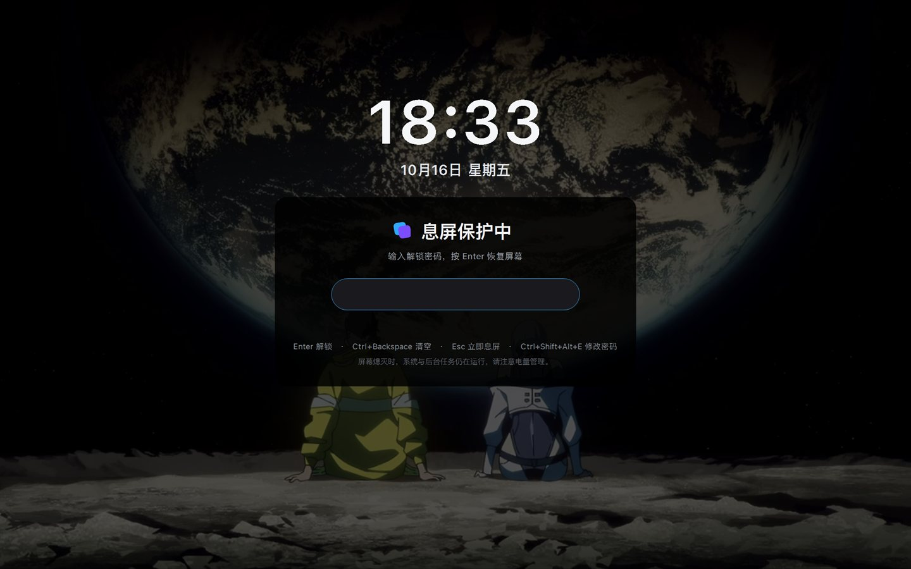
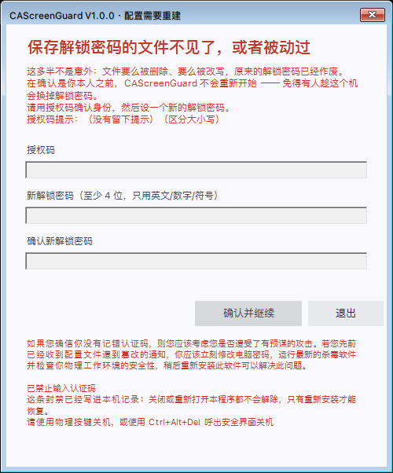

# CAScreenGuard

[English](README.md) · **简体中文**

# 来自作者：这个软件要做什么？

**在主机处于无人值守状态下，保持长流程的工作正常进行并保护您后台正在进行的工作和私密文件免于任何不可察觉的偷窥、窃取和破解手段**

# 此软件如何编写？
*与DeepSeek v4.1 flash和Kimi Code、DeepSeek Harness、WorkBuddy共同构建。*

走开时让它替你看着屏幕：**只关显示器**（不休眠、不锁定 Windows 会话、保持系统唤醒），
最上层盖一层全屏遮罩挡住桌面内容；只有输对解锁密码，才会恢复屏幕并退出。

遮罩底下是你自己的桌面壁纸（压暗后铺满整屏，读不到壁纸时退回纯黑），上方按 Windows 11 锁屏的比例
摆着时间与日期，中间是输入解锁密码的卡片 —— 所以它看起来像系统锁屏，而不是一块黑矩形。
桌面内容自始至终没有露出来。

- 版本：**V3.0.0**
- 作者：**@Conste11ation117**
- 运行环境：Windows 10 / 11，Windows PowerShell 5.1（系统自带，不需要装任何东西）
- 许可：[MIT](LICENSE)
- 与 JetBrains 无任何关联；图标风格是对其图标体系的一次致敬



*息屏时长这样：壁纸打底并压暗，上方是时间与日期（按 Win11 锁屏的比例排），中间是密码卡片。
锁屏开始时先熄屏、再在黑屏状态下把壁纸画好，所以看不到绘制过程；解锁时遮罩渐隐约 0.7 秒。*



*配置文件被删掉或改动过时，程序拒绝开锁并摆出这个窗口：先用授权码确认身份，再设一个新的解锁密码。
图里是**连错三次之后的封禁态** —— 输入全部置灰，只留「退出」，封禁已落盘，重开程序也不会解除。*

**怎么拿到它**：`git clone` 本仓库，或者到 [Releases](https://github.com/Conste11ation117/CAScreenGuard/releases)
下载 —— 仓库里那份 `CAScreenGuard-Setup.exe` 就是同一个文件。双击安装向导，两分钟装完。

每个 Release 提供两个压缩包，按需要挑最小的那个用：

- **`CAScreenGuard-Setup-windows-x86.zip`** —— 只含安装器、图标和两份 README，给"只想装一下"的机器
- **`CAScreenGuard-All.zip`** —— 整份工程（源码、安装器、文档、截图），方便离线拷走

---
## 零、元定位
**在主机处于无人值守状态下，保持长流程的工作正常进行并保护您后台正在进行的工作和私密文件免于任何不可察觉的偷窥、窃取和破解手段。**

## 一、它适合做什么、不适合做什么

**适合**：离开工位几分钟（倒水、开会、接电话）、公共或共享桌面、跑长任务时想遮住屏幕但不想让会话被系统锁掉。

**不适合**：真正需要保密的数据、防范有心人、防远程会话或别的账户、以及任何需要"安全边界"的场合。

> 它防的是**路过的人随手看一眼**，不是"有人专门来翻你的电脑"。它不锁定 Windows 会话、不加密任何东西。
>
> 它也不需要去拦 `Ctrl+Alt+Del`：**那个界面上没有任何东西能让你的桌面露出来。**
> 注销和关机只会结束这次会话（或者重启），桌面自始至终没出现过，而标记文件会把这件事记下来；
> 任务管理器确实能启动，但遮罩每 250ms 重新置顶并立刻抢回焦点，上面没有你能点到的按钮。
> 需要保密时请用 Windows 锁屏（`Win+L`）+ BitLocker。

---

## 二、锁屏期间

| 操作 | 行为 |
|---|---|
| 任意键 / 移动鼠标 | 点亮屏幕、露出密码框（桌面内容始终被挡着） |
| 解锁密码 + `Enter` | 解锁：遮罩渐隐（约 0.7 秒）→ 恢复屏幕、还原屏保设置、退出 |
| `Ctrl + Backspace`（`Ctrl + U` 同效） | 清空已输入内容 |
| `Esc` | 立刻再次熄屏（已输入内容保留） |
| 无操作 25 秒（可调） | 自动再次熄屏（已输入内容保留） |
| `Ctrl + Shift + Alt + E` | 打开「修改解锁密码」（需授权码），改完仍保持锁屏 |
| `Win` / `Alt+Tab` / `Alt+Esc` / `Ctrl+Esc` | **被吞掉**，免得有人用开始菜单、任务切换缩略图瞥见桌面 |

**息屏时长什么样**（见文首截图）：

- **壁纸打底**：启动时读取当前桌面壁纸（`SPI_GETDESKWALLPAPER`），按"填充"铺满整个虚拟桌面再压暗。
  纯色壁纸、幻灯片、文件损坏等读不到图的情况，会静默退回原来的纯黑遮罩 —— 每次启动各自判断一次。
- **时间与日期**：摆在主屏上方，用的是 Win11 锁屏的实测比例（数字高 71 DIP、顶边距 162 DIP、两行间距 32 DIP）。
  屏幕太矮会自动缩号，不会被顶出屏幕。
- **卡片压得更暗**：整屏压一层暗色，卡片那一块再压一层 —— 卡片永远比周围更暗，文字因此更清楚。
- 壁纸只在**屏幕熄灭之后**才合成与绘制，所以看不到"从上往下刷出来"的过程。
- 打底用的是你自己的桌面壁纸：它本来就是解锁后任何人都能看到的那张图，不构成新的信息暴露。
  如果你介意，把桌面壁纸设成纯色，程序会自动退回纯黑。

**连错封禁**：解锁密码**连错 8 次**直接禁止继续输入，屏幕下方显示「已禁止输入密码」+
「请使用物理按键关机，或使用 Ctrl+Alt+Del 呼出安全界面关机」；授权码**连错 3 次**会禁用窗口内
全部输入（输入框与确定按钮置灰，只留退出/取消），并先给出一条红色警告：若确信没记错授权码，
就应考虑是否遭遇有预谋的攻击 —— 立刻修改电脑密码、运行杀毒软件、检查物理工作环境的安全性。

**输错授权码不给任何提示** —— 既不确认"你猜的这个不对"，也不告诉还剩几次机会，省得有人拿它当
试错通道。机会用完的那一刻直接进封禁状态。

**两种封禁的力度不一样**：

| 发生位置 | 连错 3 次之后 |
|---|---|
| `Ctrl+Shift+Alt+E` 的"修改解锁密码" | 本次运行内禁止（关掉程序重开就恢复） |
| 配置被动过时的"配置需要重建" | **永久封禁**：写进注册表与 `%APPDATA%` 各一份，关掉重开、重启电脑都不解除，只有重新安装才能清掉 |

后一种按"配置被人动过 + 三次拿不出授权码"看待 —— 这不是手滑，是有预谋的尝试，所以不给第二次机会。

**睡眠**：锁屏期间挂 `SetThreadExecutionState(ES_CONTINUOUS | ES_SYSTEM_REQUIRED)`，
拦住"闲着没人动、系统自己睡过去/休眠"；**故意不带** `ES_DISPLAY_REQUIRED`，否则会和关屏打架。
它不拦"你主动让它睡"，也不修改你的电源方案。

---

## 三、密码、授权码与篡改检测

| | 解锁密码 | 授权码 |
|---|---|---|
| 用途 | 日常解锁屏幕 | **忘记解锁密码时唯一的凭据** |
| 长度 / 字符 | 至少 4 位，只能用英文/数字/符号 | 至少 6 位，同规则 |
| 存储 | PBKDF2-SHA1，12 万次迭代 + 随机盐，只存哈希 | 同左 |
| 能否更改 | 可以（要过授权码这一关） | **安装时定版，不能再改** |

配置文件 `.cascreenguard.config.json`（隐藏，与脚本同目录）里带一段 **HMAC-SHA256 摘要**，
密钥存在两处外部凭证里：注册表 `HKCU\Software\CAScreenGuard` 与 `%APPDATA%\CAScreenGuard\store.json`。
文件被删掉或改动哪怕一个字节，下次启动就**拒绝开锁**、强烈警告，并要求先用授权码确认身份再重建。

**程序里没有任何人的密码。** 密码由安装向导当场收集、算成哈希后写进配置与外部凭证；
脚本、C#、exe 里都不存在密码字面值。

---

## 四、关机 / 崩溃监测

- 进入锁屏时写标记 `%LOCALAPPDATA%\CAScreenGuard\running.flag`，正常解锁退出时删除。
- 下次启动若发现它还在，说明上次没正常结束，会分两种情况告诉你：
  - **有崩溃日志** → 软件自身出错，给出日志路径，请连同复现步骤反馈
    （日志在 `%LOCALAPPDATA%\CAScreenGuard\crash-*.log`，自动只留最近 10 份）；
  - **没有崩溃日志** → 不是它崩的：可能是有人按了电源键、用 `Ctrl+Alt+Del` 注销/关机，或者直接结束了进程。
    会提示你立刻修改电脑密码、运行杀毒软件、检查物理工作环境的安全性，然后重新安装。
- 另有一份运行流水账 `%LOCALAPPDATA%\CAScreenGuard\guard.log`：记启动/退出、睡眠恢复、唤醒请求重发失败、
  界面线程异常，超过 64KB 自动截断。**里面不写用户名、机器名、路径和 PID**，可以放心发出来排错
  （只有 `crash-*.log` 里才有 `user@machine` 和 pid —— 那是本机日志，不用发）。

---

## 五、安装 / 卸载

双击 `CAScreenGuard-Setup.exe`：

1. **欢迎页** —— 程序图标、欢迎标题、作者与许可信息、程序简介、杀毒软件提示、说明文档入口、
   以及**界面语言**选择（简体中文 / English）。
2. **安装页** —— 安装位置（含「会装到…」实时预览）· 解锁密码 · 授权码 · 授权码提示 · 快捷键。

说明：

- 实际装在 `你选的位置\CAScreenGuard-当天日期\` 这个专属子文件夹里：
  同名文件夹已存在 → **拒绝安装**；本机已装过 → **覆盖重装**（先删掉上一套再装新的）。
- 自动创建桌面快捷方式，带**全局快捷键** `Ctrl + Alt + <字母/数字>`（写进快捷方式的「快捷键」字段，
  不需要常驻进程、不需要开机自启）。
- 注册到「应用和功能」（开发者 `Conste11ation117`）；卸载会删除注册表、外部凭证、桌面快捷方式
  **以及整个安装文件夹**。
- **装到没有写权限的位置**（例如 `C:\Program Files`）时，安装器会给出完整失败原因（含异常类型与
  `HResult`，可选中复制），并提供**「以管理员身份重试」**：同意 Windows 的授权提示（UAC）后，由一个
  提权助手建好目录、把写权限授给你当前这个账户，然后继续安装。密码与授权码不经过命令行；装完的文件
  所有者是你自己，之后写配置、日志和卸载都不需要再提权。
- 用 `conhost --headless` 启动，**双击不会闪终端窗口**。
- 安装时选的语言会写进外部凭证，装好的程序按它显示。

### 杀毒软件

实测：**360 会给出提示但不会判定为病毒，Windows Defender 完全放行**。如果你信任本软件，
建议把它加入杀毒软件的信任目录／白名单，否则安装或运行时可能被拦截（欢迎页上也写了这句）。

---

## 六、界面语言

中英文两套文案都在程序里：

- 安装时选定的语言记在外部凭证里，启动时按它显示
- 凭证里没有记录时，跟随你的 Windows 显示语言
- 也可以临时强制：`CAScreenGuard.ps1 -Lang zh` 或 `-Lang en`

---

## 七、文件构成

### 运行时需要的四份（必须放在同一个目录）

`CAScreenGuard.ps1` · `ScreenLockEarly.cs` · `ScreenLockNative.cs` · `CAScreenGuard.ico`

脚本启动时用 `Add-Type -Path` 加载那两个 `.cs`；缺任何一个会弹「文件不完整」并退出 ——
**不要只把 `.ps1` 单独拷走**。

### 工程目录

| 文件 | 说明 |
|---|---|
| `CAScreenGuard-demo.ps1` | **主脚本源码**（带注释，要改就改它） |
| `CAScreenGuard.ps1` | **由 demo 自动生成**：去掉全部注释与空行（发布版） |
| `ScreenLockEarly.cs` / `ScreenLockNative.cs` | C# 源码（带注释） |
| `make-icon.ps1` | 重新生成图标 |
| `build-setup.ps1` | 打包：去注释 → 嵌入 → 编译成单文件 exe |
| `Installer.cs` | 安装器源码（欢迎页、向导、安装/卸载、中英文案表） |
| `CAScreenGuard.ico` | 图标 |
| `CAScreenGuard-Setup.exe` | 打包产物 ← 双击这个装 |
| `docs/` | README 用的截图 |

> `CAScreenGuard.ps1` 是**生成物，不要直接改**；要改请改 `CAScreenGuard-demo.ps1`。

---

## 八、开发与自检

```powershell
powershell -File build-setup.ps1
```

这一条命令会：

1. 用 PowerShell **语法树**去掉 `CAScreenGuard-demo.ps1` 的全部注释与空行（字符串里的 `#` 不受影响），
   只保留 `#Requires`，生成 `CAScreenGuard.ps1`
2. 去掉两个 `.cs` 的注释，**并先编译一遍确认没删坏**
3. 归一化所有源文件的 BOM 与行尾（编辑工具常把 BOM 吃掉，会让中文变乱码）
4. 把四份文件嵌进安装器，编译成 `CAScreenGuard-Setup.exe`

自检（不会关屏）：

```powershell
powershell -File CAScreenGuard.ps1 -SelfTest
```

8 项：配置文件读写、错误密码不接受、配置完整性判定（正常/被改/被删）、遮罩尺寸、
界面构建、空闲计时接口、错误密码处理、正确密码解锁。

| 参数 | 说明 |
|---|---|
| `-ResetPassword` | 直接打开「修改解锁密码」（需授权码；这一次不熄屏） |
| `-IdleBlankSeconds <5..600>` | 无人操作多久自动再次熄屏，默认 25 秒 |
| `-Lang auto\|zh\|en` | 强制界面语言 |
| `-Ver` | 只显示版本与作者，然后退出（不熄屏） |
| `-SelfTest` | 自检，不会关屏 |

---

## 九、关于"防破解"（如实说）

脚本里没有秘密可破解：解锁密码只以 PBKDF2 哈希存在，摘要密钥在外部凭证里 ——
把脚本从头读到尾也拿不到密码，更拿不到绕过校验的钥匙。

去注释、混淆、打包成 exe 都**不会真的提高安全性**：释放出来的 `.ps1` 照样在硬盘上，
而 .NET 的 IL 反编译比读脚本还容易。根本原因是：**能改掉这个程序的人就能绕过它** ——
换掉脚本、或者直接结束进程。任何用户态遮挡程序都逃不出这条。

真正能提高门槛的是：收紧安装目录的 ACL、别把密码写在便签或提示里、
需要保密时用 `Win+L` + BitLocker、以及用受控账户。

---

## 十、已知边界

- 同账户的攻击者如果把注册表键和 `%APPDATA%` 那份凭证**一起清掉**，就会退化成"从来没装过"；
  程序会拒绝开锁并要求重新安装（失败安全，但原配置也就用不了了）
- 所有输入框都禁用了中文输入法，密码/授权码只收半角字符
- 遮罩盖住的是整块虚拟桌面（多显示器一起盖）
- 锁屏期间**系统保持唤醒**，笔记本上会比较费电
- `Ctrl+Alt+Del` **不是**一个口子：那个界面上没有能看到桌面的操作（详见第一节）
- 不覆盖的情况：能改程序文件的人，或者能用别的方式结束进程的人（另一个账户、把盘挂到别的机器上等）——
  标记文件只能在事后告诉你发生过
